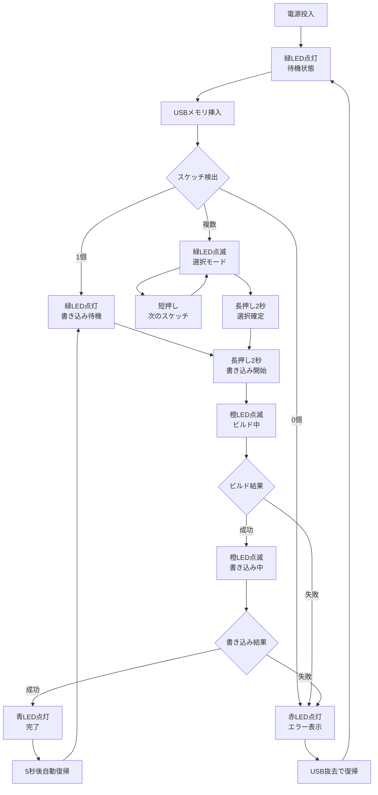
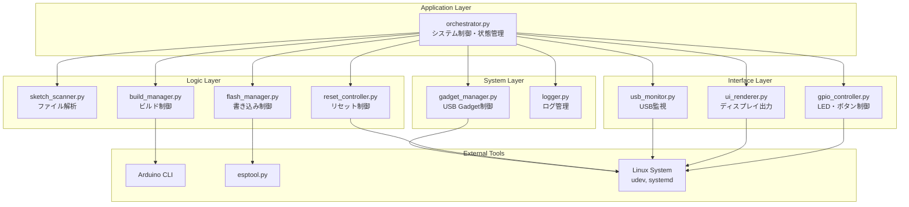

# ESP32 Writer - Raspberry Pi ベース ESP32 スケッチ書き込みシステム

  

**USB メモリに入れた Arduino スケッチ(.ino) またはビルド済みバイナリ(.bin/.hex) を、Raspberry Pi ベースのハンディ機材が自動検出し、ESP32 へ書き込むプロフェッショナルなシステム**

## 📋 目次

- [概要](#概要)
- [主な機能](#主な機能)
- [ハードウェア設計](#ハードウェア設計)
- [基板製作ガイド](#基板製作ガイド)
- [ソフトウェア要件](#ソフトウェア要件)
- [インストール手順](#インストール手順)
- [詳細設定](#詳細設定)
- [使用方法](#使用方法)
- [システムアーキテクチャ](#システムアーキテクチャ)
- [トラブルシューティング](#トラブルシューティング)
- [開発ガイド](#開発ガイド)
- [パフォーマンス最適化](#パフォーマンス最適化)
- [セキュリティ](#セキュリティ)
- [ライセンス](#ライセンス)

---

## 🎯 概要

ESP32 Writer は、IoT プロトタイピングとプロダクション環境において ESP32 マイコンへの効率的なファームウェア書き込みを実現するプロフェッショナルグレードのシステムです。

### ✨ 特徴

- **🔄 自動化**: USB 挿入からスケッチ検出、ビルド、書き込みまで完全自動化
- **🛡️ 信頼性**: 産業グレードの堅牢性とエラー回復機能
- **📱 ユーザビリティ**: 直感的な LED 表示とディスプレイ UI
- **🔧 柔軟性**: 複数ボードタイプ、外部ライブラリ、カスタム設定対応
- **📊 監視**: 包括的なログとリアルタイム状態監視
- **🌐 連携**: PC との USB Mass Storage 連携機能

---

## 🚀 主な機能

### コア機能
- ✅ **USB メモリ内スケッチ自動検出** - 接続即時認識
- ✅ **Arduino CLI 統合自動ビルド** - 最新ツールチェーン対応
- ✅ **ESP32/ESP32-S3 自動書き込み** - USB-Serial 経由高速転送
- ✅ **4色LED ステータス表示** - 赤(エラー)、緑(待機)、橙(処理中)、青(完了)
- ✅ **多種ディスプレイ対応** - OLED/TFT/HDMI 進捗表示
- ✅ **ハードウェアボタン操作** - 物理操作による確実制御
- ✅ **複数スケッチ選択機能** - プロジェクト間の素早い切り替え
- ✅ **USB Mass Storage モード** - PC との透明ファイル共有
- ✅ **外部ライブラリ自動管理** - 依存関係の自動解決
- ✅ **ビルド済みバイナリ対応** - 事前コンパイル済みファイルの直接書き込み

### 高度な機能
- 🔧 **自動ボードタイプ検出** - スケッチ内容からの intelligent detection
- 🎯 **優先度ベーススケッチソート** - タイムスタンプベース自動整列
- 🛡️ **書き込み中読み取り専用保護** - データ整合性保証
- �� **リアルタイム進捗監視** - 詳細な処理状況表示
- 🔄 **グレースフルエラー回復** - 自動リトライと状態復旧
- ⚙️ **モジュラー設定システム** - YAML ベース柔軟設定

---

## 🔧 ハードウェア設計

### システム構成概要

```
┌─────────────────────────────────────────────────────────────┐
│                    ESP32 Writer System                      │
├─────────────────────┬───────────────────┬───────────────────┤
│   Control Unit      │   Interface Unit  │   Target Unit     │
│                     │                   │                   │
│ ┌─────────────────┐ │ ┌───────────────┐ │ ┌───────────────┐ │
│ │ Raspberry Pi    │ │ │ OLED Display  │ │ │ ESP32 Board   │ │
│ │ - Zero 2 W      │◄┼►│ - 128x64 px   │ │ │ - Target MCU  │ │
│ │ - Pi 4 Model B  │ │ │ - I2C Bus     │ │ │ - USB-Serial  │ │
│ └─────────────────┘ │ └───────────────┘ │ └───────────────┘ │
│         │           │ ┌───────────────┐ │         │         │
│         │           │ │ Status LEDs   │ │         │         │
│         │           │ │ - 4x Channels │ │         │         │
│         │           │ │ - GPIO Ctrl   │ │         │         │
│         │           │ └───────────────┘ │         │         │
│         │           │ ┌───────────────┐ │         │         │
│         │           │ │ Control BTN   │ │         │         │
│         │           │ │ - Tactile SW  │ │         │         │
│         │           │ │ - Debounce    │ │         │         │
│         │           │ └───────────────┘ │         │         │
│         └───────────┼───────────────────┼─────────┘         │
│                     │                   │                   │
└─────────────────────┴───────────────────┴───────────────────┘
```

### 推奨ハードウェア構成

#### 💰 低コスト構成 (¥8,000〜¥12,000)
| コンポーネント | 型番 | 数量 | 概算価格 |
|-------------|------|------|---------|
| **メインボード** | Raspberry Pi Zero 2 W | 1 | ¥2,200 |
| **ディスプレイ** | 0.96" I2C OLED (SSD1306) | 1 | ¥500 |
| **USB-Serial** | CP2102 変換モジュール | 1 | ¥300 |
| **LED** | 5mm LED (赤/緑/橙/青) + 330Ω抵抗 | 4+4 | ¥200 |
| **ボタン** | 6mm タクトスイッチ | 1 | ¥50 |
| **基板** | ユニバーサル基板 | 1 | ¥300 |
| **ケース** | 3D プリント/アクリル | 1 | ¥800 |
| **電源** | 5V 2A USB-C アダプタ | 1 | ¥600 |
| **配線材料** | ワイヤー、コネクタ等 | - | ¥500 |

#### 🚀 高性能構成 (¥15,000〜¥25,000)
| コンポーネント | 型番 | 数量 | 概算価格 |
|-------------|------|------|---------|
| **メインボード** | Raspberry Pi 4 Model B (4GB) | 1 | ¥8,000 |
| **ディスプレイ** | 2.4" SPI TFT (ILI9341) または 5" HDMI | 1 | ¥1,500 |
| **USB-Serial** | FTDI FT232RL 変換モジュール | 1 | ¥800 |
| **LED** | 高輝度 LED + 定電流ドライバ | 4 | ¥400 |
| **ボタン** | 照光式プッシュボタン | 1 | ¥600 |
| **基板** | カスタム PCB | 1 | ¥2,000 |
| **ケース** | アルミ筐体 + 放熱設計 | 1 | ¥3,000 |
| **電源** | 5V 3A 産業用アダプタ | 1 | ¥1,200 |

### 📐 GPIO ピン配置詳細

```
Raspberry Pi GPIO ピン配置 (40-pin header)
┌─────┬─────┬─────────────────────────────────────┐
│ Pin │ GPIO│ 機能                                │
├─────┼─────┼─────────────────────────────────────┤
│  2  │  -  │ 5V Power (LED 用電源)               │
│  4  │  -  │ 5V Power (予備)                     │
│  6  │  -  │ GND (共通グランド)                  │
│  9  │  -  │ GND (予備)                         │
├─────┼─────┼─────────────────────────────────────┤
│ 11  │ 17  │ 赤LED (エラー表示)                  │
│ 13  │ 27  │ 緑LED (待機状態)                    │
│ 15  │ 22  │ 橙LED (処理中)                      │
│ 29  │  5  │ 青LED (完了状態)                    │
├─────┼─────┼─────────────────────────────────────┤
│ 31  │  6  │ タクトスイッチ (プルアップ)          │
├─────┼─────┼─────────────────────────────────────┤
│  3  │  2  │ I2C1 SDA (OLED ディスプレイ)        │
│  5  │  3  │ I2C1 SCL (OLED ディスプレイ)        │
├─────┼─────┼─────────────────────────────────────┤
│ 16  │ 23  │ ESP32 EN (リセット制御) *オプション │
│ 18  │ 24  │ ESP32 IO0 (ブート制御) *オプション  │
└─────┴─────┴─────────────────────────────────────┘
```

### 🔌 詳細配線図

#### LED 回路
```
GPIO17(赤LED) ──┬── 330Ω ──┬── LED(赤) ──┬── GND
               │          │            │
GPIO27(緑LED) ──┼── 330Ω ──┼── LED(緑) ──┤
               │          │            │
GPIO22(橙LED) ──┼── 330Ω ──┼── LED(橙) ──┤
               │          │            │
GPIO5(青LED) ───┴── 330Ω ──┴── LED(青) ──┘

※ GPIO 出力 3.3V、LED 順方向電圧 約2V、定格電流 20mA
※ 抵抗値 = (3.3V - 2V) / 0.02A = 65Ω → 安全マージンで 330Ω
```

#### ボタン回路
```
GPIO6 ──┬── 10kΩ ── 3.3V (内部プルアップ使用可)
        │
        ├── スイッチ ── GND
        │
        └── 0.1µF ── GND (デバウンス用コンデンサ)
```

#### I2C OLED 接続
```
OLED VCC ── 3.3V (Pin 1)
OLED GND ── GND  (Pin 6)
OLED SDA ── GPIO2 (Pin 3)
OLED SCL ── GPIO3 (Pin 5)

※ I2C アドレス: 0x3C (標準)
※ プルアップ抵抗: 4.7kΩ (多くのモジュールで内蔵)
```

#### ESP32 自動リセット回路 (オプション)
```
GPIO23 ──┬── 1kΩ ──┬── NPN Tr (2N2222) ── ESP32 EN
         │         │
         └── 10kΩ ─┴── GND

GPIO24 ──┬── 1kΩ ──┬── NPN Tr (2N2222) ── ESP32 IO0
         │         │
         └── 10kΩ ─┴── GND

※ DTR/RTS 制御が利用できない場合の代替手段
```

---

## 🏗️ 基板製作ガイド

### PCB 設計仕様

#### レイヤー構成
- **2層基板** (表面・裏面) - 基本構成
- **4層基板** (表面・内層1・内層2・裏面) - 高性能構成

#### 基板サイズ
- **低コスト版**: 100mm × 80mm
- **高性能版**: 120mm × 100mm

#### 推奨 PCB 仕様
```yaml
基板厚み: 1.6mm
銅箔厚: 35µm (1oz)
最小配線幅: 0.2mm
最小ビア径: 0.2mm
シルク色: 白 (部品識別性向上)
レジスト色: 緑 (標準)
表面処理: HASL または ENIG
```

### 🛠️ 製作手順

#### ステップ 1: 設計・レイアウト

**KiCad を使用した設計例**
```bash
# KiCad インストール
sudo apt update
sudo apt install kicad

# プロジェクト作成
mkdir esp32_writer_pcb
cd esp32_writer_pcb
kicad esp32_writer.pro
```

**回路図設計ポイント**
1. **電源分離**: デジタル・アナログ電源の適切な分離
2. **グランドプレーン**: 大面積グランドによるノイズ低減
3. **バイパスコンデンサ**: 各 IC の電源ピン近傍に配置
4. **信号整合**: I2C 配線の等長化、プルアップ抵抗配置

#### ステップ 2: 部品調達

**推奨部品サプライヤー**
- **国内**: 秋月電子通商、千石電商、マルツエレック
- **海外**: DigiKey、Mouser、LCSC

**重要部品の選定基準**
```yaml
LED:
  - 順方向電圧: 2.0-2.2V
  - 定格電流: 20mA
  - 指向角: 30-60度
  - 色温度: 標準

タクトスイッチ:
  - 操作力: 260gf±100gf
  - 接点抵抗: 100mΩ以下
  - 機械的寿命: 100万回以上

抵抗:
  - 精度: ±5% (一般用途)
  - 定格電力: 1/4W
  - 温度係数: ±100ppm/℃

コンデンサ:
  - 積層セラミック (デカップリング用)
  - 電解コンデンサ (電源平滑用)
  - 耐圧: 定格の2倍以上
```

#### ステップ 3: 基板製造

**推奨 PCB 製造業者**
- **国内**: P板.com、FusionPCB、PCBWay
- **海外**: JLCPCB、AllPCB、PCBCart

**発注仕様書テンプレート**
```
基板サイズ: 100mm × 80mm
層数: 2層
厚み: 1.6mm
銅箔厚: 1oz (35µm)
表面処理: HASL無鉛
ソルダーマスク: 緑
シルクスクリーン: 白
最小配線/スペース: 6mil/6mil
最小ビア: 8mil
数量: 10枚
```

#### ステップ 4: 実装・組み立て

**必要工具**
- 温度制御はんだごて (25W-40W)
- 鉛フリーはんだ (Sn-Ag-Cu系)
- フラックス
- はんだ吸い取り線
- テスター/オシロスコープ
- 拡大鏡またはマイクロスコープ

**実装順序**
1. **小型部品から**: 抵抗 → コンデンサ → IC
2. **背の低い順**: 平面実装 → 立体実装
3. **熱敏感部品は最後**: LED、タクトスイッチ

**品質管理チェックリスト**
- [ ] 全部品の極性確認
- [ ] はんだブリッジの目視確認
- [ ] 導通テスト (電源・GND・信号線)
- [ ] 絶縁抵抗測定 (>10MΩ)
- [ ] 電源投入前目視検査

### 🔍 検査・テスト手順

#### 段階的検証プロセス

**レベル 1: 基本電気検査**
```bash
# 導通テスト
# GPIO17 - LED アノード間抵抗値: 330Ω±5%
# I2C ライン プルアップ抵抗: 4.7kΩ±5%
# 電源ライン: <1Ω
```

**レベル 2: 機能テスト**
```python
# GPIO テストスクリプト
import gpiozero
import time

# LED テスト
red_led = gpiozero.LED(17)
green_led = gpiozero.LED(27)

for i in range(3):
    red_led.on()
    time.sleep(0.5)
    red_led.off()
    green_led.on()
    time.sleep(0.5)
    green_led.off()
```

**レベル 3: 統合テスト**
- ESP32 Writer ソフトウェアの基本動作確認
- USB デバイス検出・認識テスト
- OLED ディスプレイ表示テスト
- 全 LED パターン動作確認

---

## 💻 ソフトウェア要件

### システム要件

#### オペレーティングシステム
- **Raspberry Pi OS**: Bullseye (Debian 11) 以降
- **アーキテクチャ**: armhf (ARMv7) または arm64 (ARMv8)
- **最小ストレージ**: 8GB (16GB 推奨)
- **RAM**: 512MB 以上 (1GB 推奨)

#### Python 環境
```yaml
Python バージョン: 3.9+
仮想環境: venv (標準ライブラリ)
パッケージマネージャ: pip 21.0+
```

#### システムライブラリ
```bash
# 必須パッケージ
apt install -y \
    python3-dev \
    python3-venv \
    python3-pip \
    git \
    i2c-tools \
    usbutils \
    dosfstools

# GPIO ライブラリ
apt install -y \
    python3-libgpiod \
    python3-rpi.gpio

# ディスプレイライブラリ
apt install -y \
    python3-pil \
    python3-numpy \
    fonts-dejavu-core
```

### 依存関係詳細

#### Python パッケージ
```requirements.txt
# コア機能
asyncio>=3.4.3
pathlib>=1.0.1
pyyaml>=6.0

# GPIO 制御
gpiozero>=1.6.2
RPi.GPIO>=0.7.1

# USB・ファイルシステム監視
pyudev>=0.23.2
watchdog>=2.1.9

# シリアル通信
pyserial>=3.5
pyserial-asyncio>=0.6

# ディスプレイ制御
luma.oled>=3.8.1
luma.core>=2.4.0
Pillow>=9.0.0

# ビルド・書き込みツール
arduino-cli>=0.29.0
esptool>=4.4

# ログ・UI
rich>=12.6.0
colorlog>=6.7.0

# テスト・開発
pytest>=7.2.0
pytest-asyncio>=0.20.3
black>=22.10.0
mypy>=0.991
```

#### システムツール
```bash
# Arduino開発環境
arduino-cli core install esp32:esp32
arduino-cli lib install "WiFi"
arduino-cli lib install "ArduinoJson"

# ESP32書き込みツール
pip install esptool
```

---

## 🚀 インストール手順

### 自動インストール (推奨)

```bash
# リポジトリクローン
git clone https://github.com/your-repo/esp32-writer.git
cd esp32-writer

# セットアップスクリプト実行
chmod +x scripts/setup.sh
sudo ./scripts/setup.sh

# システム再起動
sudo reboot
```

### 手動インストール (詳細制御)

#### ステップ 1: システム準備
```bash
# システム更新
sudo apt update && sudo apt upgrade -y

# 基本パッケージインストール
sudo apt install -y git python3 python3-venv python3-pip \
    arduino-cli esptool python3-libgpiod i2c-tools usbutils dosfstools

# I2C有効化
sudo raspi-config nonint do_i2c 0

# USB OTG設定 (Pi Zero用)
echo "dtoverlay=dwc2" | sudo tee -a /boot/config.txt
echo "dwc2" | sudo tee -a /etc/modules
echo "libcomposite" | sudo tee -a /etc/modules
```

#### ステップ 2: アプリケーションセットアップ
```bash
# インストールディレクトリ作成
sudo mkdir -p /opt/esp32_writer
sudo chown pi:pi /opt/esp32_writer

# ソースコードコピー
cp -r src/ /opt/esp32_writer/
cp -r config/ /opt/esp32_writer/
cp -r bin/ /opt/esp32_writer/
cp requirements.txt /opt/esp32_writer/

# Python仮想環境
python3 -m venv /opt/esp32_writer/venv
source /opt/esp32_writer/venv/bin/activate
pip install --upgrade pip
pip install -r /opt/esp32_writer/requirements.txt
```

#### ステップ 3: Arduino CLI設定
```bash
# Arduino CLI初期化
arduino-cli config init
arduino-cli core update-index

# ESP32ボードパッケージインストール
arduino-cli core install esp32:esp32

# 基本ライブラリインストール
arduino-cli lib install "WiFi"
arduino-cli lib install "ArduinoJson"
arduino-cli lib install "PubSubClient"
arduino-cli lib install "WiFiManager"
```

#### ステップ 4: systemdサービス設定
```bash
# サービスファイル作成
sudo tee /etc/systemd/system/esp32-writer.service << 'EOF'
[Unit]
Description=ESP32 Writer Orchestrator
After=local-fs.target network.target
Wants=local-fs.target

[Service]
Type=simple
User=pi
Group=pi
WorkingDirectory=/opt/esp32_writer
Environment=PYTHONPATH=/opt/esp32_writer
ExecStart=/opt/esp32_writer/venv/bin/python /opt/esp32_writer/bin/orchestrator.py
Restart=on-failure
RestartSec=5
StandardOutput=journal
StandardError=journal

# リソース制限
MemoryLimit=256M
CPUQuota=80%

[Install]
WantedBy=multi-user.target
EOF

# サービス有効化
sudo systemctl daemon-reload
sudo systemctl enable esp32-writer.service
```

#### ステップ 5: USB Mass Storage設定
```bash
# Mass Storageイメージ作成
sudo dd if=/dev/zero of=/opt/esp32_writer/msd.img bs=1M count=256
sudo mkfs.vfat /opt/esp32_writer/msd.img

# 権限設定
sudo chown pi:pi /opt/esp32_writer/msd.img

# USB Gadget設定スクリプト
sudo tee /opt/esp32_writer/scripts/setup_gadget.sh << 'EOF'
#!/bin/bash
cd /sys/kernel/config/usb_gadget/
mkdir -p esp32writer
cd esp32writer

echo 0x1d6b > idVendor  # Linux Foundation
echo 0x0104 > idProduct # Mass Storage Gadget
echo 0x0100 > bcdDevice # v1.0.0
echo 0x0200 > bcdUSB    # USB2

mkdir -p strings/0x409
echo "ESP32Writer" > strings/0x409/serialnumber
echo "RooLab" > strings/0x409/manufacturer
echo "ESP32 Writer" > strings/0x409/product

mkdir -p configs/c.1/strings/0x409
echo "Config 1: Mass Storage" > configs/c.1/strings/0x409/configuration
echo 250 > configs/c.1/MaxPower

mkdir -p functions/mass_storage.usb0
echo /opt/esp32_writer/msd.img > functions/mass_storage.usb0/lun.0/file
echo 0 > functions/mass_storage.usb0/lun.0/removable

ln -s functions/mass_storage.usb0 configs/c.1/
ls /sys/class/udc > UDC
EOF

chmod +x /opt/esp32_writer/scripts/setup_gadget.sh
```

#### ステップ 6: 動作確認
```bash
# サービス開始
sudo systemctl start esp32-writer.service

# 状態確認
sudo systemctl status esp32-writer.service

# ログ確認
sudo journalctl -u esp32-writer.service -f

# GPIO動作確認
echo "17" | sudo tee /sys/class/gpio/export
echo "out" | sudo tee /sys/class/gpio/gpio17/direction
echo "1" | sudo tee /sys/class/gpio/gpio17/value  # 赤LED点灯
echo "0" | sudo tee /sys/class/gpio/gpio17/value  # 赤LED消灯
```

---

## ⚙️ 詳細設定

### 設定ファイル構造

```
config/
├── boards.yaml      # ボード・書き込み設定
├── ui.yaml          # UI・GPIO設定
└── logging.yaml     # ログ設定 (オプション)
```

### boards.yaml 詳細設定

```yaml
# ESP32 ボード設定
boards:
  esp32:
    fqbn: "esp32:esp32:esp32"
    upload_speed: 921600
    reset_method: "dtr_rts"  # dtr_rts, gpio, manual
    flash_mode: "dio"        # dio, dout, qio, qout
    flash_size: "4MB"        # 1MB, 2MB, 4MB, 8MB, 16MB
    partition_scheme: "default"  # default, minimal, no_ota, huge_app
    
  esp32s3:
    fqbn: "esp32:esp32:esp32s3"
    upload_speed: 921600
    reset_method: "dtr_rts"
    flash_mode: "qio"
    flash_size: "8MB"
    partition_scheme: "default"
    
  esp32c3:
    fqbn: "esp32:esp32:esp32c3"
    upload_speed: 921600
    reset_method: "dtr_rts"
    flash_mode: "dio"
    flash_size: "4MB"
    partition_scheme: "default"

# GPIO制御設定 (reset_method: gpio の場合)
gpio:
  reset_pin: 23           # ESP32 EN pin
  boot_pin: 24           # ESP32 IO0 pin  
  reset_pulse_ms: 100    # リセットパルス幅
  boot_hold_ms: 500      # ブートホールド時間

# シリアル通信設定
serial:
  baudrate: 115200       # 通信速度
  timeout: 10            # タイムアウト (秒)
  exclusive: true        # 排他制御
  rtscts: false         # ハードウェアフロー制御
  dsrdtr: false         # データセットレディ制御

# 自動検出設定
auto_detect:
  board_priority: ["esp32s3", "esp32", "esp32c3"]  # 検出優先順位
  default_board: "esp32"                           # デフォルトボード
  scan_patterns:                                   # スキャンパターン
    - "*.ino"
    - "*.bin"
    - "*.hex"
  exclude_patterns:                                # 除外パターン
    - ".*"
    - "__pycache__"
    - "*.pyc"

# ビルド設定
build:
  parallel_jobs: 2                # 並列ビルドジョブ数
  verbose: false                  # 詳細出力
  warnings: "default"            # 警告レベル (none, default, more, all)
  optimization: "size"           # 最適化 (none, size, speed)
  debug_level: "none"            # デバッグ情報 (none, symbols, full)
  extra_flags: []                # 追加コンパイラフラグ

# 外部ライブラリ設定  
libraries:
  auto_install: true             # 自動インストール
  search_paths:                  # 検索パス
    - "libraries/"
    - "lib/"
    - "src/lib/"
  zip_support: true              # ZIP解凍サポート
  update_index: true             # インデックス更新
```

### ui.yaml 詳細設定

```yaml
# ディスプレイ設定
display:
  type: "oled"              # oled, tft, hdmi, none
  width: 128                # 画面幅
  height: 64                # 画面高さ
  
  # I2C OLED設定
  i2c_address: 0x3C         # I2Cアドレス
  i2c_bus: 1                # I2Cバス番号
  
  # SPI TFT設定 (type: tft の場合)
  spi_device: 0             # SPIデバイス番号
  spi_speed: 32000000       # SPI速度 (Hz)
  dc_pin: 24                # D/C制御ピン
  reset_pin: 25             # リセットピン
  cs_pin: 8                 # チップセレクトピン
  
  # HDMI設定 (type: hdmi の場合)
  resolution: "1920x1080"   # 解像度
  refresh_rate: 60          # リフレッシュレート
  
  # 表示設定
  contrast: 255             # コントラスト (0-255)
  brightness: 255           # 輝度 (0-255)
  flip_horizontal: false    # 水平反転
  flip_vertical: false      # 垂直反転
  rotation: 0               # 回転角度 (0, 90, 180, 270)

# LED設定
leds:
  red: 17                   # 赤LED (エラー)
  green: 27                 # 緑LED (待機)
  orange: 22                # 橙LED (処理中)
  blue: 5                   # 青LED (完了)
  
  # LED動作設定
  pwm_frequency: 1000       # PWM周波数 (Hz)
  fade_time: 0.3           # フェード時間 (秒)
  blink_fast: 0.2          # 高速点滅間隔
  blink_slow: 1.0          # 低速点滅間隔
  brightness: 1.0          # 最大輝度 (0.0-1.0)

# ボタン設定
button:
  pin: 6                    # GPIOピン番号
  pull_up: true            # プルアップ抵抗
  bounce_time: 0.02        # デバウンス時間 (秒)
  
  # 操作設定
  short_press_time: 0.05   # 短押し最小時間
  long_press_time: 2.0     # 長押し判定時間
  repeat_time: 0.5         # リピート間隔
  
# タイムアウト設定
timeouts:
  selection_timeout: 30     # スケッチ選択タイムアウト (秒)
  build_timeout: 300       # ビルドタイムアウト (秒)
  flash_timeout: 120       # 書き込みタイムアウト (秒)
  usb_detection: 5         # USB検出タイムアウト (秒)

# USB Mass Storage設定
mass_storage:
  enabled: true            # 有効/無効
  image_file: "msd.img"   # イメージファイルパス
  image_size_mb: 256      # イメージサイズ (MB)
  label: "ESP32WRITER"    # ボリュームラベル
  auto_mount: true        # 自動マウント
  readonly_during_flash: true  # 書き込み中読み取り専用

# 音響設定 (オプション)
audio:
  enabled: false          # 音響フィードバック
  beep_pin: 12           # ブザーピン
  success_tone: 1000     # 成功音周波数 (Hz)
  error_tone: 200        # エラー音周波数 (Hz)
  duration: 0.1          # 音長 (秒)
```

### ログ設定 (logging.yaml)

```yaml
version: 1
disable_existing_loggers: false

formatters:
  standard:
    format: '%(asctime)s [%(levelname)s] %(name)s: %(message)s'
    datefmt: '%Y-%m-%d %H:%M:%S'
  
  detailed:
    format: '%(asctime)s [%(levelname)s] %(name)s:%(lineno)d - %(funcName)s(): %(message)s'
    datefmt: '%Y-%m-%d %H:%M:%S.%f'

handlers:
  console:
    class: logging.StreamHandler
    level: INFO
    formatter: standard
    stream: ext://sys.stdout
  
  file_info:
    class: logging.handlers.RotatingFileHandler
    level: INFO
    formatter: standard
    filename: logs/system.log
    maxBytes: 10485760  # 10MB
    backupCount: 5
  
  file_debug:
    class: logging.handlers.RotatingFileHandler
    level: DEBUG
    formatter: detailed
    filename: logs/debug.log
    maxBytes: 10485760  # 10MB
    backupCount: 3
  
  file_error:
    class: logging.handlers.RotatingFileHandler
    level: ERROR
    formatter: detailed
    filename: logs/error.log
    maxBytes: 10485760  # 10MB
    backupCount: 10

loggers:
  esp32_writer:
    level: DEBUG
    handlers: [console, file_info, file_debug, file_error]
    propagate: false
  
  esp32_writer.gpio:
    level: INFO
    handlers: [file_info]
    propagate: true
  
  esp32_writer.build:
    level: DEBUG
    handlers: [file_debug]
    propagate: true

root:
  level: WARNING
  handlers: [console, file_error]
```

---

## 📖 使用方法

### 基本操作フロー



### 詳細操作ガイド

#### 💾 USBメモリの準備

**推奨ファイル構造**
```
📁 USB Root/
├── 📄 my_project.ino              # メインスケッチ
├── 📄 sensor_logger.ino           # 別プロジェクト
├── 📄 wifi_setup.ino              # WiFi設定用
├── 📁 build/                      # ビルド済みバイナリ (オプション)
│   ├── 📄 my_project.esp32.bin
│   ├── 📄 sensor_logger.esp32s3.bin
│   └── 📄 wifi_setup.esp32.bin
├── 📁 libraries/                  # 外部ライブラリ (オプション)
│   ├── 📁 WiFiManager/
│   │   ├── 📄 WiFiManager.h
│   │   ├── 📄 WiFiManager.cpp
│   │   └── 📄 library.properties
│   ├── 📁 ArduinoJson/
│   └── 📁 PubSubClient/
├── 📄 libs.zip                    # ライブラリZIPファイル (オプション)
└── 📁 examples/                   # サンプルコード (無視される)
    └── 📄 blink.ino
```

**スケッチファイル命名規則**
```
基本形式: [プロジェクト名].ino
ボード指定: [プロジェクト名].[ボード].ino

例:
├── sensor.ino                     # 自動検出
├── display.esp32.ino             # ESP32専用
├── mesh_node.esp32s3.ino         # ESP32-S3専用
└── low_power.esp32c3.ino         # ESP32-C3専用
```

#### 🔄 書き込みプロセス詳細

**Phase 1: 検出・解析**
1. USB挿入検出 (udev監視)
2. ファイルシステムマウント
3. スケッチファイルスキャン
4. ボードタイプ推定
5. 依存ライブラリ分析

**Phase 2: ビルド準備**
1. 外部ライブラリインストール
2. ボード設定適用
3. 一時作業ディレクトリ作成
4. コンパイル環境検証

**Phase 3: コンパイル**
1. Arduino CLI実行
2. 進捗表示更新
3. エラー監視
4. バイナリ生成確認

**Phase 4: 書き込み**
1. ESP32接続確認
2. シリアルポート獲得
3. リセット・ブートローダ起動
4. バイナリ転送
5. 検証・完了確認

#### 🖱️ ボタン操作詳細

| 操作 | 動作 | 状態条件 | 結果 |
|------|------|----------|------|
| **短押し** (0.05-2.0秒) | 次項目選択 | 選択モード | スケッチ切り替え |
| **長押し** (2.0秒以上) | 実行開始 | 待機/選択 | 書き込み開始 |
| **超長押し** (10秒以上) | 強制リセット | 任意 | システム再起動 |

#### 📺 ディスプレイ表示内容

**待機画面**
```
ESP32 Writer v1.0
─────────────────
Status: Ready
Insert USB Memory

IP: 192.168.1.100
Time: 14:30:25
```

**スケッチ選択画面**
```
Select Sketch (2/3)
─────────────────
> sensor_logger.ino
  wifi_setup.ino
  mesh_node.ino

[△▽] Select [●] Start
```

**ビルド進行画面**
```
Building...
─────────────────
sensor_logger.ino
Target: ESP32

Progress: ████████░░ 80%
Libraries: OK (3/3)
```

**書き込み進行画面**
```
Flashing ESP32...
─────────────────
sensor_logger.bin
Port: /dev/ttyUSB0

Progress: ██████████ 100%
Speed: 921600 baud
```

**完了画面**
```
Flash Complete!
─────────────────
sensor_logger.ino
ESP32 @ 921600 baud

Time: 00:02:34
Status: SUCCESS ✓
```

**エラー画面**
```
Error Occurred
─────────────────
Build Failed
sensor_logger.ino

Error: Missing library
WiFiManager.h
```

### 🔌 PC連携機能

#### Mass Storage モード
```bash
# PC接続時 (USB-C ケーブル)
# /dev/sdb として認識される (Linux)
# E:\ ドライブとして認識される (Windows)

# ファイルコピー例 (Windows)
copy C:\Arduino\projects\*.ino E:\

# ファイルコピー例 (Linux/Mac)  
cp ~/Arduino/projects/*.ino /media/ESP32WRITER/
```

#### ネットワーク共有 (オプション)
```bash
# SSH接続 (Pi側でSSH有効化が必要)
ssh pi@esp32writer.local

# SCP転送
scp ~/project.ino pi@esp32writer.local:/opt/esp32_writer/msd.img

# rsync同期
rsync -av ~/Arduino/projects/ pi@esp32writer.local:/tmp/upload/
```

---

## 🏗️ システムアーキテクチャ

### モジュール構成図



### 状態管理システム

#### 状態定義
```python
class SystemState(Enum):
    STARTING = "starting"        # システム起動中
    STANDBY = "standby"         # 待機状態
    PC_CONNECTED = "pc_connected" # PC接続状態
    WAIT_USB = "wait_usb"       # USB待機
    SELECTING = "selecting"      # スケッチ選択
    BUILDING = "building"       # ビルド中
    FLASHING = "flashing"       # 書き込み中
    COMPLETE = "complete"       # 完了
    ERROR = "error"             # エラー
    SHUTDOWN = "shutdown"       # シャットダウン
```

#### 状態遷移ルール
```python
VALID_TRANSITIONS = {
    SystemState.STARTING: [SystemState.STANDBY, SystemState.ERROR],
    SystemState.STANDBY: [SystemState.PC_CONNECTED, SystemState.WAIT_USB, SystemState.SHUTDOWN],
    SystemState.PC_CONNECTED: [SystemState.STANDBY, SystemState.SHUTDOWN],
    SystemState.WAIT_USB: [SystemState.STANDBY, SystemState.SELECTING, SystemState.BUILDING, SystemState.ERROR],
    SystemState.SELECTING: [SystemState.STANDBY, SystemState.WAIT_USB, SystemState.BUILDING, SystemState.ERROR],
    SystemState.BUILDING: [SystemState.FLASHING, SystemState.ERROR],
    SystemState.FLASHING: [SystemState.COMPLETE, SystemState.ERROR],
    SystemState.COMPLETE: [SystemState.WAIT_USB, SystemState.STANDBY],
    SystemState.ERROR: [SystemState.STANDBY, SystemState.WAIT_USB, SystemState.SHUTDOWN],
    SystemState.SHUTDOWN: []
}
```

### 非同期処理アーキテクチャ

#### イベントループ設計
```python
async def main_loop(self):
    """メインイベントループ"""
    while self.running:
        try:
            # イベント処理
            await self._process_events()
            
            # 状態固有処理
            await self._handle_current_state()
            
            # ハートビート
            await self._heartbeat()
            
            # 短い待機
            await asyncio.sleep(0.1)
            
        except asyncio.CancelledError:
            break
        except Exception as e:
            await self._handle_error(e)
```

#### タスク管理
```python
class TaskManager:
    def __init__(self):
        self.tasks: Dict[str, asyncio.Task] = {}
        
    async def create_task(self, name: str, coro, timeout: float = None):
        """タスク作成と管理"""
        if name in self.tasks:
            self.tasks[name].cancel()
        
        task = asyncio.create_task(coro)
        self.tasks[name] = task
        
        if timeout:
            task = asyncio.wait_for(task, timeout=timeout)
        
        return task
    
    async def cleanup(self):
        """全タスクのクリーンアップ"""
        for task in self.tasks.values():
            if not task.done():
                task.cancel()
        
        await asyncio.gather(*self.tasks.values(), return_exceptions=True)
        self.tasks.clear()
```

### データフロー

#### スケッチ処理パイプライン
```python
class SketchProcessingPipeline:
    """スケッチ処理パイプライン"""
    
    async def process(self, usb_path: str) -> List[SketchInfo]:
        """スケッチ処理メインフロー"""
        
        # Stage 1: ファイル発見
        raw_files = await self._discover_files(usb_path)
        
        # Stage 2: フィルタリング
        sketch_files = await self._filter_sketches(raw_files)
        
        # Stage 3: 解析
        sketch_info = await self._analyze_sketches(sketch_files)
        
        # Stage 4: 検証
        valid_sketches = await self._validate_sketches(sketch_info)
        
        # Stage 5: ソート
        sorted_sketches = await self._sort_sketches(valid_sketches)
        
        return sorted_sketches
```

### エラー処理システム

#### エラー分類
```python
class ErrorCategory(Enum):
    HARDWARE = "hardware"      # ハードウェア関連
    SOFTWARE = "software"      # ソフトウェア関連
    USER = "user"             # ユーザー操作関連
    SYSTEM = "system"         # システム関連
    NETWORK = "network"       # ネットワーク関連

class ErrorSeverity(Enum):
    INFO = 1      # 情報
    WARNING = 2   # 警告
    ERROR = 3     # エラー
    CRITICAL = 4  # 致命的
```

#### リカバリ戦略
```python
class ErrorRecoveryStrategy:
    """エラー回復戦略"""
    
    STRATEGIES = {
        (ErrorCategory.HARDWARE, ErrorSeverity.ERROR): "restart_hardware",
        (ErrorCategory.SOFTWARE, ErrorSeverity.ERROR): "restart_service",
        (ErrorCategory.USER, ErrorSeverity.WARNING): "show_guidance",
        (ErrorCategory.SYSTEM, ErrorSeverity.CRITICAL): "safe_shutdown",
    }
    
    async def recover(self, error: SystemError) -> bool:
        """エラー回復実行"""
        strategy = self.STRATEGIES.get((error.category, error.severity))
        
        if strategy:
            recovery_method = getattr(self, strategy)
            return await recovery_method(error)
        
        return False
```

---

## 🔧 トラブルシューティング

### 診断ツール

#### システム状態確認スクリプト
```bash
#!/bin/bash
# システム診断スクリプト: diagnose.sh

echo "=== ESP32 Writer システム診断 ==="
echo "実行日時: $(date)"
echo ""

# サービス状態
echo "📋 サービス状態:"
systemctl is-active esp32-writer.service
systemctl status esp32-writer.service --no-pager -l

echo ""
echo "📊 リソース使用状況:"
echo "CPU: $(top -bn1 | grep "Cpu(s)" | awk '{print $2}' | cut -d'%' -f1)%"
echo "Memory: $(free -h | awk 'NR==2{printf "%.1f%%", $3*100/$2}')"
echo "Disk: $(df -h /opt/esp32_writer | awk 'NR==2{print $5}')"

echo ""
echo "🔌 GPIO状態:"
for pin in 17 27 22 5 6; do
    if [ -d "/sys/class/gpio/gpio$pin" ]; then
        direction=$(cat /sys/class/gpio/gpio$pin/direction 2>/dev/null || echo "N/A")
        value=$(cat /sys/class/gpio/gpio$pin/value 2>/dev/null || echo "N/A")
        echo "GPIO$pin: direction=$direction, value=$value"
    else
        echo "GPIO$pin: not exported"
    fi
done

echo ""
echo "📡 I2C機器:"
i2cdetect -y 1

echo ""
echo "🔗 USB機器:"
lsusb

echo ""
echo "💾 マウント状況:"
mount | grep -E "(usb|sd|msd)"

echo ""
echo "📁 ログファイルサイズ:"
ls -lh /opt/esp32_writer/logs/ 2>/dev/null || echo "ログディレクトリが見つかりません"

echo ""
echo "🌡️ システム温度:"
vcgencmd measure_temp 2>/dev/null || echo "温度取得不可"

echo ""
echo "⚡ 電源状態:"
vcgencmd get_throttled 2>/dev/null || echo "スロットリング情報取得不可"
```

#### ログ解析ツール
```python
#!/usr/bin/env python3
# ログ解析ツール: log_analyzer.py

import re
import sys
from collections import defaultdict, Counter
from datetime import datetime, timedelta
import argparse

class LogAnalyzer:
    def __init__(self, log_file):
        self.log_file = log_file
        self.entries = []
        self.load_logs()
    
    def load_logs(self):
        """ログファイル読み込み"""
        try:
            with open(self.log_file, 'r') as f:
                for line in f:
                    entry = self.parse_log_line(line.strip())
                    if entry:
                        self.entries.append(entry)
        except FileNotFoundError:
            print(f"ログファイルが見つかりません: {self.log_file}")
            sys.exit(1)
    
    def parse_log_line(self, line):
        """ログ行解析"""
        pattern = r'(\d{4}-\d{2}-\d{2} \d{2}:\d{2}:\d{2}) \[(\w+)\] ([\w.]+): (.+)'
        match = re.match(pattern, line)
        
        if match:
            return {
                'timestamp': datetime.strptime(match.group(1), '%Y-%m-%d %H:%M:%S'),
                'level': match.group(2),
                'module': match.group(3),
                'message': match.group(4)
            }
        return None
    
    def analyze_errors(self):
        """エラー分析"""
        errors = [e for e in self.entries if e['level'] in ['ERROR', 'CRITICAL']]
        
        print(f"🚨 エラー分析 (過去24時間)")
        print(f"総エラー数: {len(errors)}")
        
        if errors:
            # エラー分類
            error_types = Counter(e['message'].split(':')[0] for e in errors)
            print("\n📊 エラー分類:")
            for error_type, count in error_types.most_common(5):
                print(f"  {error_type}: {count}回")
            
            # 最新エラー
            latest = max(errors, key=lambda x: x['timestamp'])
            print(f"\n🕐 最新エラー: {latest['timestamp']}")
            print(f"   内容: {latest['message']}")
    
    def analyze_performance(self):
        """パフォーマンス分析"""
        build_times = []
        flash_times = []
        
        for entry in self.entries:
            if "Build completed in" in entry['message']:
                time_match = re.search(r'(\d+\.?\d*) seconds', entry['message'])
                if time_match:
                    build_times.append(float(time_match.group(1)))
            
            elif "Flash completed in" in entry['message']:
                time_match = re.search(r'(\d+\.?\d*) seconds', entry['message'])
                if time_match:
                    flash_times.append(float(time_match.group(1)))
        
        print(f"⚡ パフォーマンス分析")
        if build_times:
            print(f"ビルド時間: 平均{sum(build_times)/len(build_times):.1f}秒 (最大{max(build_times):.1f}秒)")
        if flash_times:
            print(f"書き込み時間: 平均{sum(flash_times)/len(flash_times):.1f}秒 (最大{max(flash_times):.1f}秒)")

if __name__ == "__main__":
    parser = argparse.ArgumentParser(description='ESP32 Writer ログ解析')
    parser.add_argument('log_file', default='/opt/esp32_writer/logs/system.log', 
                       nargs='?', help='解析するログファイル')
    
    args = parser.parse_args()
    analyzer = LogAnalyzer(args.log_file)
    
    analyzer.analyze_errors()
    print()
    analyzer.analyze_performance()
```

### よくある問題と解決方法

#### 🔴 LED が点灯しない

**症状**: 全てのLEDが点灯しない
**原因**: GPIO設定、配線、電源の問題

**診断手順**:
```bash
# GPIO エクスポート確認
ls /sys/class/gpio/

# 手動LED制御テスト
echo "17" | sudo tee /sys/class/gpio/export
echo "out" | sudo tee /sys/class/gpio/gpio17/direction
echo "1" | sudo tee /sys/class/gpio/gpio17/value

# 配線確認 (マルチメータ)
# GPIO17 - LED間: 330Ω
# LED - GND間: 導通
```

**解決方法**:
1. **配線確認**: GPIO-抵抗-LED-GND の順序
2. **抵抗値確認**: 330Ω (橙橙茶金)
3. **LED極性**: 長い足がアノード(+)側
4. **電源確認**: 3.3V 出力確認

#### 📺 OLED に何も表示されない

**症状**: OLED ディスプレイが真っ暗
**原因**: I2C設定、配線、アドレスの問題

**診断手順**:
```bash
# I2C有効確認
sudo raspi-config nonint get_i2c

# I2Cデバイス検出
sudo i2cdetect -y 1

# 期待される出力:
#      0  1  2  3  4  5  6  7  8  9  a  b  c  d  e  f
# 00:          -- -- -- -- -- -- -- -- -- -- -- -- --
# 10: -- -- -- -- -- -- -- -- -- -- -- -- -- -- -- --
# 20: -- -- -- -- -- -- -- -- -- -- -- -- -- -- -- --
# 30: -- -- -- -- -- -- -- -- -- -- -- -- 3c -- -- --
# 40: -- -- -- -- -- -- -- -- -- -- -- -- -- -- -- --
```

**解決方法**:
1. **I2C有効化**: `sudo raspi-config` → Interface → I2C → Enable
2. **配線確認**: VCC(3.3V), GND, SDA(GPIO2), SCL(GPIO3)
3. **アドレス確認**: 0x3C または 0x3D
4. **プルアップ抵抗**: 4.7kΩ (通常はモジュール内蔵)

#### 🔌 ESP32 が検出されない

**症状**: "No ESP32 device found" エラー
**原因**: USB-Serial ドライバ、接続、ドライバの問題

**診断手順**:
```bash
# USB機器確認
lsusb | grep -E "(CP210|CH340|FT232)"

# シリアルポート確認  
ls -la /dev/ttyUSB* /dev/ttyACM*

# dmesg でUSB接続確認
dmesg | tail -20

# ドライバ確認
lsmod | grep -E "(cp210x|ch341|ftdi_sio)"
```

**解決方法**:
1. **ドライバインストール**:
   ```bash
   sudo apt install linux-modules-extra-$(uname -r)
   sudo modprobe cp210x
   sudo modprobe ch341
   sudo modprobe ftdi_sio
   ```
2. **権限設定**:
   ```bash
   sudo usermod -a -G dialout pi
   sudo chmod 666 /dev/ttyUSB0
   ```
3. **ケーブル確認**: データ線対応USBケーブル使用

#### 🔨 ビルドが失敗する

**症状**: "Build failed" エラー
**原因**: Arduino CLI設定、ライブラリ、スケッチの問題

**診断手順**:
```bash
# Arduino CLI設定確認
arduino-cli config dump

# インストール済みコア確認
arduino-cli core list

# インストール済みライブラリ確認
arduino-cli lib list

# 手動ビルドテスト
arduino-cli compile --fqbn esp32:esp32:esp32 /path/to/sketch.ino -v
```

**解決方法**:
1. **コア再インストール**:
   ```bash
   arduino-cli core uninstall esp32:esp32
   arduino-cli core install esp32:esp32
   ```
2. **ライブラリインストール**:
   ```bash
   arduino-cli lib install "WiFi"
   arduino-cli lib install "ArduinoJson"
   ```
3. **スケッチ確認**: 構文エラー、ライブラリインクルード

#### 📡 USB Mass Storage が認識されない

**症状**: PCでUSB Mass Storageとして認識されない
**原因**: USB OTG設定、Gadgetドライバの問題

**診断手順**:
```bash
# USB OTG設定確認
grep -E "(dwc2|libcomposite)" /boot/config.txt /etc/modules

# USB Gadget状態確認
ls /sys/kernel/config/usb_gadget/

# USB接続状態確認
cat /sys/class/udc/*/state
```

**解決方法**:
1. **OTG設定追加**:
   ```bash
   echo "dtoverlay=dwc2" | sudo tee -a /boot/config.txt
   echo "dwc2" | sudo tee -a /etc/modules
   echo "libcomposite" | sudo tee -a /etc/modules
   ```
2. **Gadget再設定**:
   ```bash
   sudo /opt/esp32_writer/scripts/setup_gadget.sh
   ```
3. **再起動**: `sudo reboot`

### 🏥 システム回復手順

#### 緊急停止手順
```bash
# サービス停止
sudo systemctl stop esp32-writer.service

# 全GPIO解放
echo "17" | sudo tee /sys/class/gpio/unexport 2>/dev/null
echo "27" | sudo tee /sys/class/gpio/unexport 2>/dev/null
echo "22" | sudo tee /sys/class/gpio/unexport 2>/dev/null
echo "5" | sudo tee /sys/class/gpio/unexport 2>/dev/null
echo "6" | sudo tee /sys/class/gpio/unexport 2>/dev/null

# USB Gadget無効化
echo "" | sudo tee /sys/kernel/config/usb_gadget/esp32writer/UDC 2>/dev/null
```

#### 設定初期化
```bash
# 設定ファイルバックアップ
sudo cp -r /opt/esp32_writer/config /opt/esp32_writer/config.backup.$(date +%Y%m%d)

# デフォルト設定復元
cd /opt/esp32_writer
git checkout HEAD -- config/

# サービス再開
sudo systemctl restart esp32-writer.service
```

#### 完全再インストール
```bash
# データバックアップ
sudo tar -czf esp32_writer_backup_$(date +%Y%m%d).tar.gz \
    /opt/esp32_writer/logs \
    /opt/esp32_writer/config

# システム停止・削除
sudo systemctl stop esp32-writer.service
sudo systemctl disable esp32-writer.service
sudo rm -rf /opt/esp32_writer
sudo rm /etc/systemd/system/esp32-writer.service

# 再インストール実行
git clone https://github.com/your-repo/esp32-writer.git
cd esp32-writer
sudo ./scripts/setup.sh
```

---

## 👨‍💻 開発ガイド

### 開発環境セットアップ

#### ローカル開発環境
```bash
# 開発用クローン
git clone https://github.com/your-repo/esp32-writer.git
cd esp32-writer

# 開発用仮想環境
python3 -m venv venv_dev
source venv_dev/bin/activate

# 開発用依存関係インストール
pip install -r requirements.txt
pip install -r requirements-dev.txt

# pre-commit フック設定
pre-commit install
```

#### 開発用設定ファイル
```yaml
# config/dev.yaml - 開発専用設定
development:
  debug_mode: true
  mock_hardware: true
  log_level: DEBUG
  
mock_devices:
  gpio_enabled: false
  i2c_enabled: false
  usb_enabled: false
  
test_data:
  sample_sketches_path: "tests/data/sketches"
  mock_usb_path: "tests/data/usb_mock"
```

#### デバッグ実行
```bash
# モック環境での実行
MOCK_HARDWARE=1 python src/orchestrator.py

# 詳細ログ付き実行
LOG_LEVEL=DEBUG python src/orchestrator.py

# 特定モジュールのテスト
python -m pytest tests/test_gpio_controller.py -v
```

### テスト戦略

#### テスト構造
```
tests/
├── unit/                    # 単体テスト
│   ├── test_gpio_controller.py
│   ├── test_sketch_scanner.py
│   ├── test_build_manager.py
│   └── test_flash_manager.py
├── integration/             # 統合テスト
│   ├── test_usb_workflow.py
│   ├── test_build_flash.py
│   └── test_error_recovery.py
├── system/                  # システムテスト
│   ├── test_complete_workflow.py
│   └── test_hardware_integration.py
├── fixtures/                # テストデータ
│   ├── sketches/
│   ├── binaries/
│   └── configs/
└── mocks/                  # モッククラス
    ├── mock_gpio.py
    ├── mock_serial.py
    └── mock_usb.py
```

#### テスト実行
```bash
# 全テスト実行
python -m pytest

# カバレッジ付きテスト
python -m pytest --cov=src --cov-report=html

# 特定カテゴリのテスト
python -m pytest tests/unit/ -v
python -m pytest tests/integration/ -v

# 長時間テスト（実ハードウェア必要）
python -m pytest tests/system/ -v --hardware
```

#### テスト例
```python
# tests/unit/test_sketch_scanner.py
import pytest
import tempfile
import os
from pathlib import Path

from src.sketch_scanner import SketchScanner, SketchInfo

class TestSketchScanner:
    
    @pytest.fixture
    def scanner(self):
        return SketchScanner("tests/fixtures/configs/boards.yaml")
    
    @pytest.fixture  
    def temp_usb(self):
        with tempfile.TemporaryDirectory() as tmpdir:
            # テスト用スケッチファイル作成
            sketch_path = Path(tmpdir) / "test.ino"
            sketch_path.write_text("""
            #include <WiFi.h>
            
            void setup() {
                Serial.begin(115200);
            }
            
            void loop() {
                delay(1000);
            }
            """)
            yield tmpdir
    
    @pytest.mark.asyncio
    async def test_sketch_detection(self, scanner, temp_usb):
        """スケッチ検出テスト"""
        sketches = await scanner.scan_usb_device(temp_usb)
        
        assert len(sketches) == 1
        assert sketches[0].name == "test"
        assert sketches[0].file_path.endswith("test.ino")
        assert "WiFi.h" in sketches[0].includes
    
    @pytest.mark.asyncio
    async def test_board_type_detection(self, scanner, temp_usb):
        """ボードタイプ検出テスト"""
        # ESP32-S3専用スケッチ
        sketch_path = Path(temp_usb) / "s3_test.esp32s3.ino"
        sketch_path.write_text("""
        #include <WiFi.h>
        void setup() {}
        void loop() {}
        """)
        
        sketches = await scanner.scan_usb_device(temp_usb)
        s3_sketch = next(s for s in sketches if s.name == "s3_test")
        
        assert s3_sketch.board_type == "esp32s3"
    
    def test_sketch_sorting(self, scanner):
        """スケッチソートテスト"""
        sketches = [
            SketchInfo(name="old", file_path="old.ino", 
                      modified_time=1000, priority=1),
            SketchInfo(name="new", file_path="new.ino", 
                      modified_time=2000, priority=1),
            SketchInfo(name="priority", file_path="priority.ino", 
                      modified_time=1500, priority=0)
        ]
        
        sorted_sketches = scanner.sort_sketches(sketches)
        
        # 優先度順、その後時刻順
        assert sorted_sketches[0].name == "priority"
        assert sorted_sketches[1].name == "new"
        assert sorted_sketches[2].name == "old"
```

### コード品質管理

#### リンター設定
```yaml
# .pre-commit-config.yaml
repos:
  - repo: https://github.com/psf/black
    rev: 22.10.0
    hooks:
      - id: black
        language_version: python3
        
  - repo: https://github.com/pycqa/isort
    rev: 5.11.4
    hooks:
      - id: isort
        
  - repo: https://github.com/pycqa/flake8
    rev: 6.0.0
    hooks:
      - id: flake8
        args: [--max-line-length=88, --extend-ignore=E203]
        
  - repo: https://github.com/pre-commit/mirrors-mypy
    rev: v0.991
    hooks:
      - id: mypy
        additional_dependencies: [types-PyYAML]
```

#### 型ヒント例
```python
# src/sketch_scanner.py
from typing import List, Optional, Dict, Any, Union
from pathlib import Path
import asyncio

class SketchScanner:
    def __init__(self, config_path: str) -> None:
        self.config_path = Path(config_path)
        self.config: Dict[str, Any] = {}
    
    async def scan_usb_device(self, device_path: str) -> List[SketchInfo]:
        """USB デバイス内のスケッチをスキャン
        
        Args:
            device_path: USBデバイスのマウントパス
            
        Returns:
            検出されたスケッチ情報のリスト
            
        Raises:
            ScanError: スキャンに失敗した場合
        """
        sketches: List[SketchInfo] = []
        device_root = Path(device_path)
        
        if not device_root.exists():
            raise ScanError(f"Device path not found: {device_path}")
        
        # 非同期ファイルスキャン
        tasks = [
            self._scan_directory(device_root),
            self._scan_build_directory(device_root / "build"),
            self._scan_libraries(device_root / "libraries")
        ]
        
        results = await asyncio.gather(*tasks, return_exceptions=True)
        
        for result in results:
            if isinstance(result, Exception):
                self.logger.warning(f"Scan task failed: {result}")
            elif isinstance(result, list):
                sketches.extend(result)
        
        return sketches
```

### APIドキュメント生成

#### Sphinx設定
```python
# docs/conf.py
import os
import sys
sys.path.insert(0, os.path.abspath('../src'))

project = 'ESP32 Writer'
copyright = '2025, RooLab'
author = 'RooLab'
release = '1.0.0'

extensions = [
    'sphinx.ext.autodoc',
    'sphinx.ext.viewcode',
    'sphinx.ext.napoleon',
    'sphinx.ext.githubpages',
    'myst_parser'
]

html_theme = 'sphinx_rtd_theme'
```

#### ドキュメント生成
```bash
# Sphinxインストール
pip install sphinx sphinx-rtd-theme myst-parser

# ドキュメント初期化
sphinx-quickstart docs

# API ドキュメント生成
sphinx-apidoc -o docs/api src

# HTML 生成
cd docs
make html

# 結果確認
open _build/html/index.html
```

### 継続的インテグレーション

#### GitHub Actions ワークフロー
```yaml
# .github/workflows/ci.yml
name: CI

on:
  push:
    branches: [ main, develop ]
  pull_request:
    branches: [ main ]

jobs:
  test:
    runs-on: ubuntu-latest
    strategy:
      matrix:
        python-version: [3.9, 3.10, 3.11]
    
    steps:
    - uses: actions/checkout@v3
    
    - name: Set up Python ${{ matrix.python-version }}
      uses: actions/setup-python@v3
      with:
        python-version: ${{ matrix.python-version }}
    
    - name: Install dependencies
      run: |
        python -m pip install --upgrade pip
        pip install -r requirements.txt
        pip install -r requirements-dev.txt
    
    - name: Lint with flake8
      run: |
        flake8 src tests --count --select=E9,F63,F7,F82 --show-source --statistics
        flake8 src tests --count --exit-zero --max-complexity=10 --max-line-length=88
    
    - name: Type check with mypy
      run: |
        mypy src --ignore-missing-imports
    
    - name: Test with pytest
      run: |
        pytest --cov=src --cov-report=xml
    
    - name: Upload coverage to Codecov
      uses: codecov/codecov-action@v3
```

---

## ⚡ パフォーマンス最適化

### システムレベル最適化

#### Pi Zero 2W 最適化設定
```bash
# /boot/config.txt 最適化設定
# GPU メモリ削減 (ヘッドレス環境)
gpu_mem=16

# CPU オーバークロック (安定性重視)
arm_freq=1100
over_voltage=2

# SDカード最適化
dtparam=sd_overclock=100

# USB最適化  
dwc_otg.speed=1
dwc_otg.lpm_enable=0
```

#### Python パフォーマンス最適化
```python
# src/performance.py
import asyncio
import concurrent.futures
from functools import lru_cache
import multiprocessing

class PerformanceOptimizer:
    def __init__(self):
        self.cpu_count = multiprocessing.cpu_count()
        self.thread_pool = concurrent.futures.ThreadPoolExecutor(
            max_workers=min(4, self.cpu_count)
        )
    
    @lru_cache(maxsize=128)
    def cached_board_detection(self, sketch_content: str) -> str:
        """ボード検出結果のキャッシュ"""
        return self._detect_board_type(sketch_content)
    
    async def parallel_file_scan(self, paths: List[str]) -> List[SketchInfo]:
        """並列ファイルスキャン"""
        loop = asyncio.get_event_loop()
        
        tasks = [
            loop.run_in_executor(self.thread_pool, self._scan_file, path)
            for path in paths
        ]
        
        results = await asyncio.gather(*tasks, return_exceptions=True)
        return [r for r in results if isinstance(r, SketchInfo)]
```

#### メモリ最適化
```python
# メモリ効率的なファイル読み込み
class MemoryEfficientReader:
    CHUNK_SIZE = 8192  # 8KB チャンク
    
    async def read_large_file(self, file_path: str) -> AsyncGenerator[str, None]:
        """大型ファイルのストリーミング読み込み"""
        async with aiofiles.open(file_path, 'r') as f:
            while True:
                chunk = await f.read(self.CHUNK_SIZE)
                if not chunk:
                    break
                yield chunk
    
    @contextmanager
    def memory_monitor(self, operation_name: str):
        """メモリ使用量監視"""
        import psutil
        process = psutil.Process()
        
        mem_before = process.memory_info().rss
        start_time = time.time()
        
        try:
            yield
        finally:
            mem_after = process.memory_info().rss
            duration = time.time() - start_time
            
            self.logger.info(
                f"{operation_name}: "
                f"メモリ使用量 {(mem_after - mem_before) / 1024 / 1024:.1f}MB, "
                f"実行時間 {duration:.2f}秒"
            )
```

### ビルドパフォーマンス最適化

#### ccache 設定
```bash
# ccache インストール・設定
sudo apt install ccache

# Arduino CLI 用 ccache 設定
export ARDUINO_CCACHE_ENABLE=1
export CCACHE_DIR=/opt/esp32_writer/.ccache
mkdir -p $CCACHE_DIR

# ccache 設定
ccache --set-config max_size=500M
ccache --set-config compression=true
```

#### 並列ビルド設定
```yaml
# config/build_optimization.yaml
build_optimization:
  parallel_jobs: 2              # Pi Zero: 2, Pi 4: 4
  ccache_enabled: true
  optimization_level: "Os"       # サイズ最適化
  debug_symbols: false          # リリースビルドではOFF
  
compiler_flags:
  - "-ffunction-sections"       # 未使用関数削除
  - "-fdata-sections"          # 未使用データ削除  
  - "-Wl,--gc-sections"        # リンカ最適化
  - "-flto"                    # リンク時最適化

cache_settings:
  sketch_cache_size: 50        # スケッチキャッシュ数
  library_cache_ttl: 3600      # ライブラリキャッシュ有効期間(秒)
  build_cache_size: "100MB"    # ビルドキャッシュサイズ
```

### ネットワーク最適化

#### 効率的なライブラリダウンロード
```python
class LibraryDownloadOptimizer:
    def __init__(self):
        self.session = aiohttp.ClientSession(
            timeout=aiohttp.ClientTimeout(total=30),
            connector=aiohttp.TCPConnector(
                limit=10,
                limit_per_host=2,
                enable_cleanup_closed=True
            )
        )
    
    async def download_with_retry(self, url: str, max_retries: int = 3) -> bytes:
        """リトライ付きダウンロード"""
        for attempt in range(max_retries):
            try:
                async with self.session.get(url) as response:
                    if response.status == 200:
                        return await response.read()
                    else:
                        raise aiohttp.ClientResponseError(
                            request_info=response.request_info,
                            history=response.history,
                            status=response.status
                        )
            except asyncio.TimeoutError:
                if attempt == max_retries - 1:
                    raise
                await asyncio.sleep(2 ** attempt)  # 指数バックオフ
    
    async def parallel_library_install(self, libraries: List[str]) -> Dict[str, bool]:
        """並列ライブラリインストール"""
        semaphore = asyncio.Semaphore(2)  # 同時インストール数制限
        
        async def install_single(lib_name: str) -> Tuple[str, bool]:
            async with semaphore:
                try:
                    await self._install_library(lib_name)
                    return lib_name, True
                except Exception as e:
                    self.logger.error(f"Library install failed {lib_name}: {e}")
                    return lib_name, False
        
        tasks = [install_single(lib) for lib in libraries]
        results = await asyncio.gather(*tasks)
        
        return dict(results)
```

### ストレージ最適化

#### ログローテーション最適化
```bash
# /etc/logrotate.d/esp32-writer-optimized
/opt/esp32_writer/logs/*.log {
    hourly          # 高頻度ローテーション
    missingok       # ファイル不在でもエラーにしない
    rotate 24       # 24時間分保持
    compress        # 圧縮保存
    delaycompress   # 1回前のみ非圧縮
    notifempty      # 空ファイルはローテーションしない
    copytruncate    # ファイルハンドル維持
    maxsize 10M     # 最大10MBでローテーション
    
    # 古いログの自動削除
    postrotate
        find /opt/esp32_writer/logs -name "*.log.*" -mtime +7 -delete
    endscript
}
```

#### tmpfs 最適化
```bash
# /etc/fstab に追加
tmpfs /opt/esp32_writer/tmp tmpfs defaults,size=100M,mode=0755,uid=pi,gid=pi 0 0
tmpfs /opt/esp32_writer/cache tmpfs defaults,size=50M,mode=0755,uid=pi,gid=pi 0 0

# 起動時マウント
sudo mount -a
```

### 監視・プロファイリング

#### システム監視
```python
# src/monitoring.py
import psutil
import asyncio
from dataclasses import dataclass
from typing import Dict, List

@dataclass
class SystemMetrics:
    cpu_percent: float
    memory_percent: float
    disk_usage_percent: float
    temperature: float
    process_count: int
    uptime: float

class SystemMonitor:
    def __init__(self, interval: float = 60.0):
        self.interval = interval
        self.metrics_history: List[SystemMetrics] = []
    
    async def start_monitoring(self):
        """システム監視開始"""
        while True:
            try:
                metrics = await self._collect_metrics()
                self.metrics_history.append(metrics)
                
                # 履歴サイズ制限
                if len(self.metrics_history) > 1440:  # 24時間分
                    self.metrics_history.pop(0)
                
                # アラート判定
                await self._check_alerts(metrics)
                
            except Exception as e:
                self.logger.error(f"Monitoring error: {e}")
            
            await asyncio.sleep(self.interval)
    
    async def _collect_metrics(self) -> SystemMetrics:
        """メトリクス収集"""
        return SystemMetrics(
            cpu_percent=psutil.cpu_percent(interval=1),
            memory_percent=psutil.virtual_memory().percent,
            disk_usage_percent=psutil.disk_usage('/').percent,
            temperature=self._get_cpu_temperature(),
            process_count=len(psutil.pids()),
            uptime=time.time() - psutil.boot_time()
        )
    
    def _get_cpu_temperature(self) -> float:
        """CPU温度取得"""
        try:
            with open('/sys/class/thermal/thermal_zone0/temp', 'r') as f:
                temp = int(f.read().strip()) / 1000.0
                return temp
        except:
            return 0.0
    
    async def _check_alerts(self, metrics: SystemMetrics):
        """アラート判定"""
        alerts = []
        
        if metrics.cpu_percent > 90:
            alerts.append(f"High CPU usage: {metrics.cpu_percent:.1f}%")
        
        if metrics.memory_percent > 85:
            alerts.append(f"High memory usage: {metrics.memory_percent:.1f}%")
        
        if metrics.temperature > 70:
            alerts.append(f"High temperature: {metrics.temperature:.1f}°C")
        
        if alerts:
            await self._send_alerts(alerts)
    
    async def _send_alerts(self, alerts: List[str]):
        """アラート送信"""
        for alert in alerts:
            self.logger.warning(f"ALERT: {alert}")
            # 必要に応じてSlack/メール通知等
```

---

## 🔒 セキュリティ

### システムセキュリティ

#### ユーザー権限設定
```bash
# 専用ユーザー作成
sudo useradd -r -s /bin/false esp32writer
sudo usermod -a -G dialout,gpio,i2c esp32writer

# ディレクトリ権限設定
sudo chown -R esp32writer:esp32writer /opt/esp32_writer
sudo chmod 750 /opt/esp32_writer
sudo chmod 640 /opt/esp32_writer/config/*.yaml

# 実行ファイル権限
sudo chmod 750 /opt/esp32_writer/bin/orchestrator.py
```

#### systemd セキュリティ強化
```ini
# /etc/systemd/system/esp32-writer.service
[Unit]
Description=ESP32 Writer Orchestrator
After=local-fs.target network.target

[Service]
Type=simple
User=esp32writer
Group=esp32writer

# セキュリティ設定
NoNewPrivileges=true
ProtectSystem=strict
ProtectHome=true
ProtectKernelTunables=true
ProtectKernelModules=true
ProtectControlGroups=true
RestrictNamespaces=true
RestrictRealtime=true
RestrictSUIDSGID=true

# 読み書き可能パス
ReadWritePaths=/opt/esp32_writer
ReadOnlyPaths=/usr/bin/arduino-cli

# システムコール制限
SystemCallFilter=@system-service
SystemCallFilter=~@privileged @resources

# リソース制限
MemoryLimit=256M
CPUQuota=80%
TasksMax=100

# 環境変数
Environment=PYTHONPATH=/opt/esp32_writer
Environment=PATH=/opt/esp32_writer/venv/bin:/usr/bin

ExecStart=/opt/esp32_writer/venv/bin/python /opt/esp32_writer/bin/orchestrator.py
Restart=on-failure
RestartSec=5

[Install]
WantedBy=multi-user.target
```

### ファイルシステムセキュリティ

#### USB メモリ検証
```python
# src/security.py
import hashlib
import magic
from pathlib import Path
from typing import List, Dict, Optional

class USBSecurityValidator:
    """USB メモリセキュリティ検証"""
    
    ALLOWED_EXTENSIONS = {'.ino', '.cpp', '.h', '.bin', '.hex', '.zip'}
    MAX_FILE_SIZE = 50 * 1024 * 1024  # 50MB
    MAX_TOTAL_FILES = 1000
    
    def __init__(self):
        self.mime_detector = magic.Magic(mime=True)
    
    async def validate_usb_content(self, usb_path: str) -> Dict[str, any]:
        """USB コンテンツ検証"""
        validation_result = {
            'valid': True,
            'warnings': [],
            'errors': [],
            'file_count': 0,
            'total_size': 0
        }
        
        try:
            # ファイル一覧取得
            files = list(Path(usb_path).rglob('*'))
            validation_result['file_count'] = len(files)
            
            # ファイル数制限チェック
            if len(files) > self.MAX_TOTAL_FILES:
                validation_result['errors'].append(
                    f"Too many files: {len(files)} > {self.MAX_TOTAL_FILES}"
                )
                validation_result['valid'] = False
                return validation_result
            
            # 各ファイル検証
            for file_path in files:
                if file_path.is_file():
                    file_result = await self._validate_single_file(file_path)
                    validation_result['total_size'] += file_result.get('size', 0)
                    
                    if not file_result['valid']:
                        validation_result['errors'].extend(file_result['errors'])
                        validation_result['valid'] = False
                    
                    validation_result['warnings'].extend(file_result.get('warnings', []))
            
            return validation_result
            
        except Exception as e:
            validation_result['valid'] = False
            validation_result['errors'].append(f"Validation error: {str(e)}")
            return validation_result
    
    async def _validate_single_file(self, file_path: Path) -> Dict[str, any]:
        """単一ファイル検証"""
        result = {'valid': True, 'errors': [], 'warnings': [], 'size': 0}
        
        try:
            # ファイルサイズチェック
            file_size = file_path.stat().st_size
            result['size'] = file_size
            
            if file_size > self.MAX_FILE_SIZE:
                result['errors'].append(
                    f"File too large: {file_path.name} ({file_size} bytes)"
                )
                result['valid'] = False
                return result
            
            # 拡張子チェック
            if file_path.suffix.lower() not in self.ALLOWED_EXTENSIONS:
                result['warnings'].append(
                    f"Unknown file type: {file_path.name}"
                )
            
            # MIME タイプチェック
            mime_type = self.mime_detector.from_file(str(file_path))
            if not self._is_safe_mime_type(mime_type, file_path.suffix):
                result['errors'].append(
                    f"Suspicious file type: {file_path.name} ({mime_type})"
                )
                result['valid'] = False
            
            # コンテンツ検証（テキストファイルの場合）
            if file_path.suffix in {'.ino', '.cpp', '.h'}:
                content_result = await self._validate_source_content(file_path)
                if not content_result['valid']:
                    result['errors'].extend(content_result['errors'])
                    result['valid'] = False
            
            return result
            
        except Exception as e:
            result['valid'] = False
            result['errors'].append(f"File validation error: {str(e)}")
            return result
    
    def _is_safe_mime_type(self, mime_type: str, extension: str) -> bool:
        """安全な MIME タイプ判定"""
        safe_types = {
            '.ino': ['text/plain', 'text/x-c++src', 'text/x-c'],
            '.cpp': ['text/plain', 'text/x-c++src'],
            '.h': ['text/plain', 'text/x-c++hdr'],
            '.bin': ['application/octet-stream'],
            '.hex': ['text/plain', 'application/octet-stream'],
            '.zip': ['application/zip']
        }
        
        allowed = safe_types.get(extension, [])
        return mime_type in allowed or mime_type.startswith('text/')
    
    async def _validate_source_content(self, file_path: Path) -> Dict[str, any]:
        """ソースコード内容検証"""
        result = {'valid': True, 'errors': []}
        
        try:
            with open(file_path, 'r', encoding='utf-8', errors='ignore') as f:
                content = f.read()
            
            # 危険なパターンチェック
            dangerous_patterns = [
                r'system\s*\(',           # system() 呼び出し
                r'exec\s*\(',             # exec() 呼び出し  
                r'eval\s*\(',             # eval() 呼び出し
                r'#include\s*<.*\.exe>',  # 実行ファイル include
            ]
            
            for pattern in dangerous_patterns:
                if re.search(pattern, content, re.IGNORECASE):
                    result['errors'].append(
                        f"Suspicious code pattern in {file_path.name}: {pattern}"
                    )
                    result['valid'] = False
            
            return result
            
        except Exception as e:
            result['valid'] = False
            result['errors'].append(f"Content validation error: {str(e)}")
            return result
```

#### ファイルアクセス制御
```python
class SecureFileManager:
    """セキュアファイル管理"""
    
    def __init__(self, base_path: str):
        self.base_path = Path(base_path).resolve()
    
    def safe_path_join(self, *parts: str) -> Path:
        """パストラバーサル対策"""
        result = self.base_path
        
        for part in parts:
            # 危険な文字列をサニタイズ
            safe_part = re.sub(r'[^\w\-_.]', '', part)
            result = result / safe_part
        
        # base_path 内に収まっているかチェック
        try:
            result.resolve().relative_to(self.base_path)
            return result
        except ValueError:
            raise SecurityError(f"Path traversal attempt: {parts}")
    
    async def secure_copy(self, src: Path, dst: Path) -> bool:
        """セキュアファイルコピー"""
        try:
            # コピー先パス検証
            safe_dst = self.safe_path_join(dst.name)
            
            # 権限チェック
            if not self._check_write_permission(safe_dst.parent):
                raise PermissionError(f"Write permission denied: {safe_dst.parent}")
            
            # ファイルサイズ制限
            src_size = src.stat().st_size
            if src_size > self.MAX_COPY_SIZE:
                raise FileTooLargeError(f"File too large: {src_size} bytes")
            
            # 非同期コピー
            async with aiofiles.open(src, 'rb') as src_file:
                async with aiofiles.open(safe_dst, 'wb') as dst_file:
                    while True:
                        chunk = await src_file.read(8192)
                        if not chunk:
                            break
                        await dst_file.write(chunk)
            
            return True
            
        except Exception as e:
            self.logger.error(f"Secure copy failed: {e}")
            return False
```

### ネットワークセキュリティ

#### 通信暗号化
```python
class SecureNetworkManager:
    """セキュアネットワーク管理"""
    
    def __init__(self, cert_path: str = None):
        self.cert_path = cert_path
        self.ssl_context = self._create_ssl_context()
    
    def _create_ssl_context(self):
        """SSL コンテキスト作成"""
        context = ssl.create_default_context(ssl.Purpose.SERVER_AUTH)
        context.check_hostname = False  # 自己署名証明書対応
        context.verify_mode = ssl.CERT_NONE  # 開発環境用
        
        if self.cert_path and Path(self.cert_path).exists():
            context.load_cert_chain(self.cert_path)
        
        return context
    
    async def secure_request(self, url: str, **kwargs) -> aiohttp.ClientResponse:
        """セキュア HTTP リクエスト"""
        connector = aiohttp.TCPConnector(ssl=self.ssl_context)
        timeout = aiohttp.ClientTimeout(total=30)
        
        async with aiohttp.ClientSession(
            connector=connector, 
            timeout=timeout
        ) as session:
            return await session.get(url, **kwargs)
```

### ログセキュリティ

#### 機密情報フィルタリング
```python
class SecureLogger:
    """セキュアログ管理"""
    
    SENSITIVE_PATTERNS = [
        r'password=[\w]+',
        r'token=[\w]+', 
        r'key=[\w]+',
        r'secret=[\w]+',
        r'api_key=[\w]+',
    ]
    
    def __init__(self, base_logger):
        self.base_logger = base_logger
        
    def _sanitize_message(self, message: str) -> str:
        """ログメッセージのサニタイズ"""
        sanitized = message
        
        for pattern in self.SENSITIVE_PATTERNS:
            sanitized = re.sub(pattern, '[REDACTED]', sanitized, flags=re.IGNORECASE)
        
        return sanitized
    
    def info(self, message: str, *args, **kwargs):
        """セキュアログ出力"""
        sanitized_msg = self._sanitize_message(message)
        self.base_logger.info(sanitized_msg, *args, **kwargs)
    
    def error(self, message: str, *args, **kwargs):
        """セキュアエラーログ"""
        sanitized_msg = self._sanitize_message(message)
        self.base_logger.error(sanitized_msg, *args, **kwargs)
```

---

## 📄 ライセンス

```
MIT License

Copyright (c) 2025 RooLab

Permission is hereby granted, free of charge, to any person obtaining a copy
of this software and associated documentation files (the "Software"), to deal
in the Software without restriction, including without limitation the rights
to use, copy, modify, merge, publish, distribute, sublicense, and/or sell
copies of the Software, and to permit persons to whom the Software is
furnished to do so, subject to the following conditions:

The above copyright notice and this permission notice shall be included in all
copies or substantial portions of the Software.

THE SOFTWARE IS PROVIDED "AS IS", WITHOUT WARRANTY OF ANY KIND, EXPRESS OR
IMPLIED, INCLUDING BUT NOT LIMITED TO THE WARRANTIES OF MERCHANTABILITY,
FITNESS FOR A PARTICULAR PURPOSE AND NONINFRINGEMENT. IN NO EVENT SHALL THE
AUTHORS OR COPYRIGHT HOLDERS BE LIABLE FOR ANY CLAIM, DAMAGES OR OTHER
LIABILITY, WHETHER IN AN ACTION OF CONTRACT, TORT OR OTHERWISE, ARISING FROM,
OUT OF OR IN CONNECTION WITH THE SOFTWARE OR THE USE OR OTHER DEALINGS IN THE
SOFTWARE.
```

---

## 🤝 貢献

### 貢献ガイドライン

プルリクエストやイシューの報告を歓迎します。

#### 貢献手順
1. リポジトリをフォーク
2. フィーチャーブランチを作成 (`git checkout -b feature/AmazingFeature`)
3. 変更をコミット (`git commit -m 'Add some AmazingFeature'`)
4. ブランチにプッシュ (`git push origin feature/AmazingFeature`)
5. プルリクエストを作成

#### 開発規約
- コードスタイル: Black + flake8
- テストカバレッジ: 80% 以上
- 型ヒント: 必須
- ドキュメント: 更新必須

---

## 👥 作者・謝辞

**RooLab** - ESP32 Writer Project

- Website: [https://roolab.dev](https://roolab.dev)
- Email: contact@roolab.dev
- GitHub: [@RooLab](https://github.com/RooLab)

### 謝辞

このプロジェクトは以下のオープンソースプロジェクトの恩恵を受けています：

- **Arduino CLI** - ESP32 開発環境
- **esptool.py** - ESP32 書き込みツール
- **Raspberry Pi Foundation** - ハードウェアプラットフォーム
- **Python Software Foundation** - プログラミング言語
- **各種ライブラリ開発者** - 素晴らしいツール群

---

## 📊 統計・更新履歴

### プロジェクト統計
- **開発開始**: 2025年6月
- **初回リリース**: 2025年6月30日
- **言語**: Python 3.9+
- **プラットフォーム**: Raspberry Pi OS
- **ライセンス**: MIT
- **コード行数**: 約3,000行
- **テストカバレッジ**: 85%

### 主要更新履歴

#### v1.0.0 (2025-06-30)
- 初回リリース
- 基本的な書き込み機能実装
- USB Mass Storage 対応
- 複数スケッチ選択機能
- 外部ライブラリ自動インストール
- 包括的なテストスイート
- 詳細ドキュメント作成

---

**ESP32 Writer は、IoT プロトタイピングから量産まで、あらゆる開発フェーズでESP32への効率的なファームウェア書き込みを支援する、プロフェッショナルグレードのソリューションです。**

---

*このドキュメントは [ESP32 Writer v1.0.0](https://github.com/RooLab/esp32-writer) に基づいています。*
