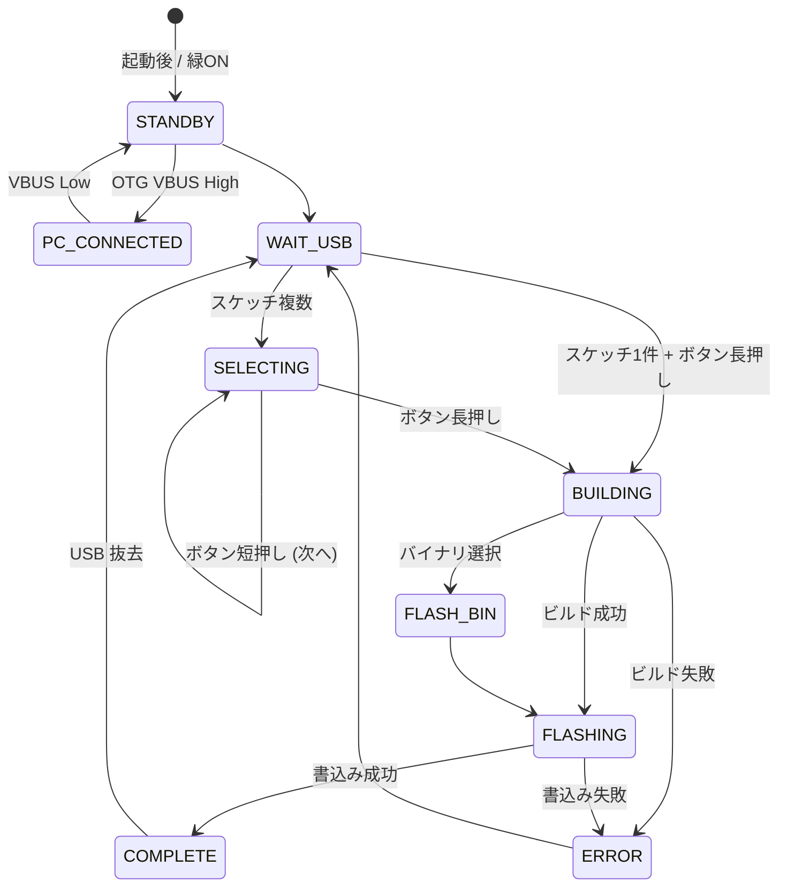

# ESP32 Writer: システム設計ドキュメント

**最終更新**: 2025-06-30  

---  

## 2. 全体概要
Raspberry Pi をベースに USB メモリ内の Arduino スケッチ(.ino) またはビルド済みバイナリ(.bin/.hex) を自動検出し、ESP32 へ書き込むハンディ機材の設計を示す。  

主機能:  
1. USB 挿入検出とスケッチ抽出  
2. ビルド（Arduino CLI）または既存バイナリ書込み  
3. 書込み状況のディスプレイ表示＋LED 表示  
4. 書込み開始ボタンによる操作、複数スケッチ選択  
5. USB Mass-Storage 共有および書込み時の保護  

---  

## 3. ハードウェア構成

| 項目 | 推奨案A (低コスト) | 推奨案B (高性能) |
|------|-------------------|-------------------|
| Raspberry Pi | Pi Zero 2 W | Pi 4 Model B (2 GB) |
| 表示 | 0.96" I2C OLED (SSD1306) / 2.4" SPI TFT (ILI9341) / 5" HDMI タッチパネル | 同左 |
| LED | GPIO17=赤, GPIO27=緑, GPIO22=橙, GPIO5=青 (各 330 Ω) | 同左 |
| ボタン | GPIO6 (プルアップ入力) | 同左 |
| ESP32 接続 | USB-Serial (CP2102/CH340) 直結 | 同左 |
| 電源 | 5 V 3 A AC アダプタ共用 | 同左 |

### 3.1 自動リセット回路

| 信号 | デフォルト | フォールバック |
|------|-----------|---------------|
| DTR / RTS | USB-Serial 経由で pyserial 制御 | Pi GPIO23→EN, GPIO24→IO0 (NPN/MOSFET 経由) |

---  

## 4. USB Mass-Storage 機能

- Pi を USB Gadget (Mass-Storage) として動作。  
- バッキングファイル `msd.img` (FAT32, 256 MB) を公開。  
- 書込み開始ボタン押下時に LUN の `ro` フラグを **0→1** に変更し読み取り専用化。  
- ro 切替失敗時は Unbind → re-Bind( ro=1 ) にフォールバック。  

### 4.1 保存ファイル構成例
```
/ (USB ルート)
├─ project1.ino
├─ project2.ino
├─ build/
│  ├─ project1.bin
│  └─ project2.bin
├─ libraries/         # 任意
└─ libs.zip           # 任意
```

---  

## 5. ソフトウェアアーキテクチャ

### 5.1 モジュール一覧

| モジュール | 役割 |
|-----------|-------|
| orchestrator | 状態機械・タスク統括 |
| usb_monitor | udev/inotify で USB 挿抜監視 |
| sketch_scanner | `.ino`, `.bin/.hex`, `libraries` 解析 |
| build_manager | Arduino CLI ビルド |
| flash_manager | esptool / arduino-cli upload |
| reset_controller | DTR/RTS または GPIO 制御 |
| gpio_controller | LED/BUTTON 制御 (gpiozero) |
| ui_renderer | OLED/TFT/HDMI 描画 |
| gadget_manager | USB Gadget ON/OFF, ro 切替 |
| logger | ログ出力 |

### 5.2 状態遷移


---  

## 6. 操作 UI

| 操作 | 挙動 | LED | 画面 |
|------|------|-----|------|
| 待機 | ボタン待ち | 緑常灯 | 「Insert USB」 |
| 短押し | スケッチ選択移動 | 緑点滅 | ファイル名表示 |
| 長押し (2s) | 書込み開始 | 橙点滅 | 進捗バー |
| 完了 | - | 青常灯 | Success |
| エラー | - | 赤常灯 | エラー内容 |

タイムアウト 30 秒無操作で待機に戻る。

---  

## 7. 外部ライブラリ取得フロー

1. `libraries/` または `libs.zip` が USB に存在する場合、`arduino-cli lib install --zip` 等でインストール。  
2. 存在しない場合は Pi 事前インストール済みライブラリを使用。  
3. ビルドログに判定結果を記録。  

---  

## 8. systemd サービス

[`/etc/systemd/system/esp32-orchestrator.service`](relative/etc/systemd/system/esp32-orchestrator.service):
```ini
[Unit]
Description=ESP32 Writer Orchestrator
After=local-fs.target

[Service]
ExecStart=/opt/esp32_writer/bin/orchestrator.py
Restart=on-failure
User=pi

[Install]
WantedBy=multi-user.target
```

---  

## 9. ディレクトリレイアウト
```
/opt/esp32_writer/
├─ bin/              # Python スクリプト
├─ config/           # boards.yaml, ui.yaml
├─ logs/             # build.log など
├─ ui/               # 画像・フォント
├─ venv/             # Python venv
└─ msd.img           # Mass-Storage バッキング
```

---  

## 10. インストール手順概要
```bash
sudo apt update
sudo apt install -y git python3-venv python3-pip arduino-cli esptool \
     python3-libgpiod i2c-tools
python3 -m venv /opt/esp32_writer/venv
source /opt/esp32_writer/venv/bin/activate
pip install gpiozero pyserial watchdog rich pillow
arduino-cli config init
arduino-cli core update-index
arduino-cli core install esp32:esp32
```

---  

## 11. リスクと拡張ポイント

| リスク | 対策 |
|--------|------|
| Pi Zero でビルド遅い | Pi 4 / ccache |
| 電源不足 | 5 V 3 A 供給 |
| USB FS 破損 | `/logs` を tmpfs |
| ro 切替失敗 | Unbind/Bind フォールバック |

**拡張例**: OTA 書込み / Web UI / CI 連携など。

---  

## 12. 参考
- Arduino CLI Docs  
- Raspberry Pi USB Gadget Docs  
- esptool.py

---  

© 2025 RooLab